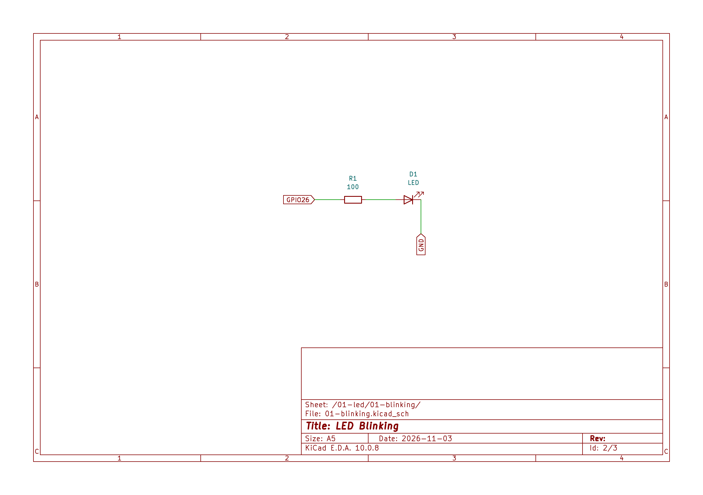

# 01.01: LED Blinking

## Overview

Learn how to control an LED with an `ESP32` by configuring a `GPIO` pin as a digital output and switching it between 
high and low states.

## Circuit


The circuit was designed in `KiCad`. The source schematic you can find in `circuits` directory at the project root.

## Implementations

This lesson contains implementations using different frameworks.

| Framework | Directory | Status |
|---|---|---|
| Arduino | [`arduino/`](arduino/) | Planned |
| ESP-IDF | [`espidf/`](esp-idf/) | Planned |
| MicroPython | [`micropy/`](micropy/) | Planned |

## How to Run

Instructions for building, flashing, and running each implementation.

### Arduino

```bash
cd arduino
pio run --target upload --environment ard-esp32dev
```

### ESP-IDF

```bash
cd espidf
TBD
```

## Expected Behavior

Describe what should happen when the program runs.

**Expected result:**
- The LED turns on.
- The LED turns off after a specified delay.
- The cycle repeats continuously.

## Notes and Findings

N/A

## References

N/A